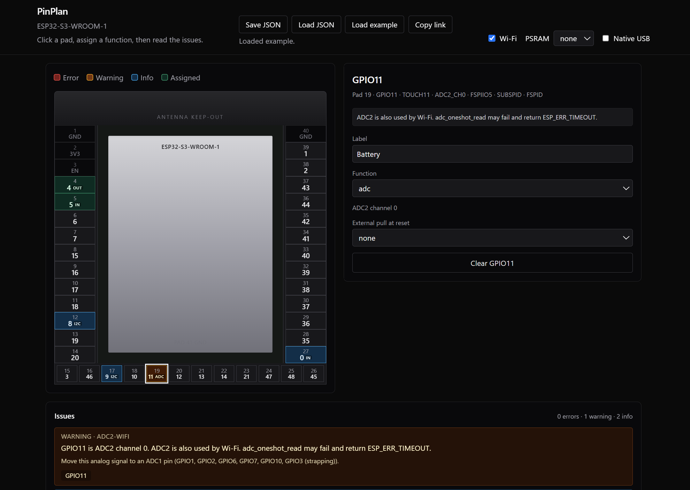

# PinPlan

[](https://github.com/khalidirineo/pinplan/actions/workflows/idf.yml)

PinPlan is a pin planner for the ESP32-S3-WROOM-1. A GPIO can be a strap, a flash pin, or shared with Wi-Fi, and that is easy to miss until the board is built. You assign functions on the module drawing, PinPlan checks those traps, and it writes a starting ESP-IDF file for the design you have.



## Features

- Pad map of the ESP32-S3-WROOM-1. One assignment per GPIO.
- Live errors, warnings, and notes for straps, flash, PSRAM, native USB, ADC2 with Wi-Fi, the UART0 console, JTAG, and too many peripherals.
- ESP-IDF v5.3+ C export. The file is still generated when the design has errors, and those errors are copied into a comment.
- Save and load a JSON file of the assignments and settings. Load example fills in an LED, a button, an I2C sensor, a battery-voltage reading on ADC2, and the GPIO0 boot strap.
- A share link in the page address. The design is gzip-compressed. There is no server.

Settings are Wi-Fi on or off, PSRAM `none`, `quad`, or `octal`, and native USB on or off.

## Run locally

```sh
npm install
npm test
npm run dev
```

Open http://localhost:5173/pinplan/ . The `/pinplan/` path matches the GitHub Pages site for a repository named `pinplan`.

`npm test` runs Vitest. `npm run build` typechecks and writes `dist/`.

## Add a rule

1. Create `src/engine/rules/myRule.ts`. Export a rule id and a function `(ctx) => Issue[]`. `ctx` is `{ chip, assignments, settings }`. Use `makeIssue` so pins are deduped and `fix` is required.
2. Register the function and the id in `src/engine/rules/index.ts`.
3. Add a `describe` block in `src/engine/evaluate.test.ts`.
4. If the rule needs a new hardware fact, put it in `src/data/chips/esp32s3.json` with a `source` and `verified: false`. Do not invent a datasheet section.

Rules should read facts from the JSON. The severity lives in the rule, because one strapping pin can be a warning or a note depending on the assignment.

An issue is `{ severity, pins, ruleId, message, fix }` with severity `error`, `warning`, or `info`.

## How pin facts are verified

Every cited object in `src/data/chips/esp32s3.json` has `source` and `verified`. `verified` is true only after that fact was compared with the cited document. The checked paths are listed in `src/data/chip.test.ts`. The test fails if a `verified` flag and that list disagree.

Checked against the ESP32-S3 Series Datasheet v2.2 and the ESP32-S3-WROOM-1 Datasheet v1.8:

- GPIO0, GPIO3, GPIO45, and GPIO46: reset pulls and boot levels. GPIO45's VDD_SPI map is Section 3.2, Table 3-4. GPIO3 has no internal pull (Section 3.4).
- A strap must hold its level for at least 3 ms after `CHIP_PU` goes high (Table 3-2, t_H).
- ADC2 on GPIO11-20 can return `ESP_ERR_TIMEOUT` from `adc_oneshot_read` while Wi-Fi is running. That citation is the ESP-IDF adc_oneshot docs, not the channel map.

Not checked: function names, the pad map, flash and PSRAM reserved pins, peripheral counts, UART0 and JTAG labels, reset pulls on other pins, the note that 1.8 V modules (R8V/R16V) may fix VDD_SPI with an eFuse, and the note that internal GPIO pull-ups are usually too weak for I2C at 400 kHz. The technical reference manual revision is still "not checked".

The `build` workflow compiles the ESP-IDF v5.3 export for the example design and for a gpio, ADC1, ADC2, LEDC, I2C, SPI, and UART design. Those files are generated in CI from the current codegen.

`scripts/draft-esp32s3.mjs` drafted the database and will not overwrite it unless you pass `--force`. Do not re-run it after a review unless the script still preserves the checked facts.

## Limitations

This version plans the ESP32-S3-WROOM-1 only. There is no other chip, no account, no backend, and no KiCad export. The page is static.

## Credits

PinPlan code is MIT. See `LICENSE`.

Pin function names, strapping text, reset pulls, peripheral counts, and reserved-pin sets were transcribed from Espressif's [esp-gpio-tool](https://github.com/espressif/esp-gpio-tool) (Apache-2.0, commit `a1bcdb2`). The WROOM-1 pad map was transcribed from [ESP32 Pinout Studio](https://esp32pin.com) by Felix Kunz (MIT), which generated it from Espressif's KiCad libraries (Apache-2.0). See `NOTICE`.

ESP32 is a trademark of Espressif Systems. This project is not affiliated with or endorsed by Espressif.
